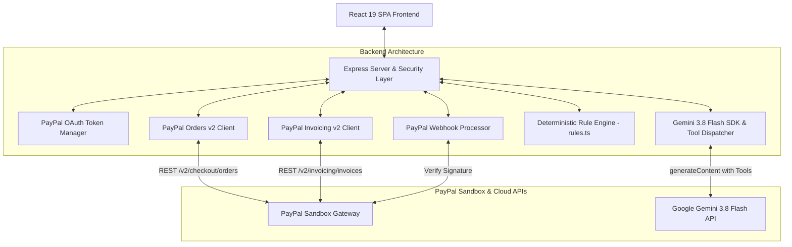

# PayPilot AI

> **Your Money In. Your Money Out. One Intelligent Financial Copilot.**  
> *Autonomous financial intelligence with deterministic guardrails, real PayPal Sandbox Orders & Invoicing, and human-in-the-loop authorization.*

[](https://nodejs.org/)
[](https://www.typescriptlang.org/)
[](https://react.dev/)
[](https://developer.paypal.com/)
[](https://aistudio.google.com/)
[](https://nodejs.org/api/test.html)
[](./LICENSE)

---

## 1. Project Introduction

**PayPilot AI** is an intelligent financial copilot built for freelancers, agency owners, and growing small businesses. It bridges the gap between **incoming receivables (Smart Invoice)** and **outgoing procurement (Smart Spend)**, continuously stress-testing decisions against an automated **12-Week Cashflow Forecast** and enforcing **deterministic spending mandates** where generative AI is never allowed to independently authorize financial commitments.

---

## 2. Problem Statement

Freelancers, agency founders, and small business operators face four critical financial challenges:

1. **Disconnected Cash Flows**: Receivables (invoicing), payables (procurement), and liquidity forecasts live in separate tools (spreadsheets, billing portals, shopping carts), making real-time cash visibility impossible.
2. **Accidental Budget & Reserve Breaches**: Unplanned hardware or software purchases frequently cause critical dips below minimum operating reserves, triggering liquidity crises.
3. **Delayed Receivables**: Overdue client invoices remain uncollected for weeks because drafting polite, professional follow-ups is manual and tedious.
4. **The "Autonomous AI" Trap**: Traditional generative AI solutions either lack real financial tool access or dangerously attempt to execute transactions autonomously without managerial consent.

---

## 3. Solution

**PayPilot AI** provides a unified, full-stack financial command center:

- **Deterministic Spending Mandates**: Non-negotiable policy guardrails that evaluate shopping carts against single-item ceilings ($250 ceiling), monthly budgets ($1,500 budget), approved categories, and cash reserve floors ($6,000 floor).
- **Controlled PayPal Sandbox Execution**: Direct integration with the **PayPal Orders API v2** (for procurement checkout and capture) and **PayPal Invoicing API v2** (for invoice drafting, dispatching, and reminder notifications).
- **Advisory AI with Human Authorization**: Gemini 3.8 Flash acts as an advisory copilot with controlled read-only and draft-preparation tools. All financial commitments require explicit human confirmation in the UI.
- **Dynamic 12-Week Cashflow Forecasting**: A probabilistic projection engine that models P20 (conservative), P50 (expected), and P80 (optimistic) liquidity curves without double-counting receivables or settled purchases.

---

## 4. Target Audience

- **Freelancers & Solopreneurs**: Independent software engineers, designers, copywriters, and consultants managing irregular income streams.
- **Boutique Agencies & Studios**: Small teams (1–20 people) needing disciplined procurement policies and fast, professional invoicing.
- **Small Business Owners**: Founders who need automated financial oversight without hiring a full-time CFO.

---

## 5. Features

- **Financial Overview Dashboard**: High-level pulse of available demo cash ($14,250), receivables ($9,000), monthly procurement spend, and interactive 12-week cashflow graph.
- **Smart Spend & Catalog**: Curated catalog of verified business gear with real-time policy evaluation. Compliant carts can proceed to Sandbox Checkout; violating items are deterministically blocked.
- **PayPal Sandbox Orders Checkout**: End-to-end checkout with real PayPal Sandbox buyer authentication, approval redirection, and idempotent server-side capture.
- **Smart Invoicing & PayPal Invoicing v2**: Natural-language invoice drafting ("Create a $1,200 invoice for website design, due in 14 days"), sandbox dispatching, and automated payment reminders.
- **Cashflow Forecast & Affordability Simulator**: 12-week projection engine modeling collections and outlays with interactive stress testing ("Can I afford an $80 purchase this week?").
- **Activity & Governance Audit Ledger**: Comprehensive timeline recording policy evaluations, approvals, and transaction IDs.
- **Clear Settlement Badging**: Visual distinction between `PAYPAL VERIFIED PAID` and `DEMO MANUAL SETTLEMENT`, plus `Captured (PayPal Sandbox)` vs `Captured (Demo Simulation)`.

---

## 6. Technology Stack

| Layer | Technologies |
| :--- | :--- |
| **Frontend Framework** | React 19 (SPA), TypeScript 5.0+, Vite 8, Tailwind CSS |
| **Icons & UI Animation**| Lucide React, Motion |
| **Backend Runtime** | Node.js (v20+), Express 4, TypeScript via `tsx` |
| **AI / LLM Engine** | Google Gen AI SDK (`@google/genai`), Gemini 3.8 Flash with deterministic fallback |
| **Payments & Invoicing**| PayPal Sandbox REST APIs (Orders v2, Invoicing v2, Webhooks) |
| **Test Runner** | Node.js Built-in Test Runner (`node:test`, `node:assert/strict`) |
| **Browser Verification**| Playwright Headless Chromium (`playwright-cli`) |

---

## 7. System Architecture



---

## 8. AI Agent Architecture

The AI Assistant (*PayPilot Copilot*) is equipped with 8 controlled, read-only or draft-preparation tools. The AI never has direct access to payment capture, purchase approvals, or database write privileges:

| Controlled Tool | Purpose | Permission Level |
| :--- | :--- | :--- |
| `searchCatalog` | Search approved business equipment catalog | Read-Only |
| `getSpendingMandate` | Inspect active monthly budget, ceiling, and categories | Read-Only |
| `evaluateCartPolicy` | Run cart through deterministic policy engine | Pure Evaluation |
| `getInvoices` | Query unpaid, overdue, and settled invoices | Read-Only |
| `prepareInvoiceDraft` | Calculate invoice line items and prepopulate draft | Draft Only (Unsent) |
| `getCashflowForecast` | Retrieve 12-week P50 liquidity curve | Read-Only |
| `simulateExpenseImpact` | Stress test cash reserve against proposed purchase | Pure Simulation |
| `getRecentPurchases` | Retrieve recent purchase approvals and receipts | Read-Only |

---

## 9. PayPal API Integration

PayPilot AI integrates three core PayPal developer products in Sandbox mode:

### 1. PayPal Orders API (v2)
- **Endpoint**: `POST /v2/checkout/orders`
- **Intent**: `CAPTURE`
- **Authoritative Recalculation**: Server calculates itemized lines and total amount from the database catalog before order creation in USD.
- **Payee Routing**: Dynamically routes to the configured Sandbox merchant ID (`PAYPAL_MERCHANT_ID`) or merchant email (`PAYPAL_PAYEE_EMAIL`).
- **Buyer Approval Flow**: Redirects buyer to `https://www.sandbox.paypal.com/checkoutnow?token={orderId}`.
- **Authoritative Capture**: `POST /v2/checkout/orders/{id}/capture` is gated on upstream order status being `APPROVED` and uses `PayPal-Request-Id` for idempotency.

### 2. PayPal Invoicing API (v2)
- **Draft Creation**: `POST /v2/invoicing/invoices` generates authoritative draft invoices with specified payment terms and due dates.
- **Dispatch**: `POST /v2/invoicing/invoices/{id}/send` delivers the invoice to the client's sandbox billing email.
- **Payment Reminders**: `POST /v2/invoicing/invoices/{id}/remind` dispatches reminder notices for overdue receivables.
- **Live Status Verification**: `GET /v2/invoicing/invoices/{id}` queries live status (`DRAFT`, `SENT`, `PAID`, `MARKED_AS_PAID`, `CANCELLED`).

### 3. PayPal Webhooks API
- **Endpoint**: `POST /api/paypal/webhooks`
- **Security**: Cryptographically validates certificate origin (`*.paypal.com`) and verifies transmission signatures using `PAYPAL_WEBHOOK_ID`.
- **Deduplication**: In-memory cache protects against replay events, returning `HTTP 200 OK` with `{ duplicate: true }`.

---

## 10. Shared Database Overview

PayPilot AI maintains synchronized in-memory stores (`purchaseApprovalsStore`, `ordersStore`, `invoicesStore`) that feed all modules:

- **Unified Cash Position**: Settle an invoice or capture a purchase, and the cash position updates simultaneously across Overview, Cashflow Forecast, and Smart Spend.
- **Traceable Identifiers**: Every record carries provider references (`paypalInvoiceId`, `sandboxTransactionId`, `captureId`).
- **Demo State Isolation**: Resetting demo data via `POST /api/reset-data` restores pristine seed records for uninterrupted judging demonstrations.

---

## 11. Security Boundaries

PayPilot AI enforces a strict zero-trust boundary for financial intelligence:

- **AI Cannot Authorize Payments**: Attempting to instruct the AI to "approve purchase", "bypass budget", "capture payment", or "mark invoice paid" results in a hard `UNAUTHORIZED_FINANCIAL_ACTION` rejection.
- **Human-in-the-Loop Requirement**: Every consequential transaction requires an explicit user button click in the UI.
- **Deterministic Evaluation**: Policy checks run in pure TypeScript code (`src/utils/rules.ts`), completely immune to prompt injection or model hallucination.
- **Credential Protection**: Client secrets, OAuth tokens, and API keys are strictly accessed server-side and never leaked in client bundles or network responses.

---

## 12. Sandbox-Only Transaction Explanation

PayPilot AI operates **exclusively in the PayPal Sandbox environment**:

- **Hard URL Isolation**: All API requests target `https://api-m.sandbox.paypal.com`. Any attempt to hit live endpoints triggers an immediate `SECURITY_VIOLATION` exception.
- **Visible Badging**: The UI permanently displays `DEMO MODE ACTIVE` and `SANDBOX` indicators across banners, modals, and tables.
- **Zero Real Funds**: No real money or bank accounts are ever connected or charged.

---

## 13. Installation Instructions

### Prerequisites
- Node.js >= 20.x installed
- npm or bun installed

### Step-by-Step Installation
```bash
# 1. Clone repository
git clone https://github.com/your-username/paypilot-ai.git
cd paypilot-ai

# 2. Install dependencies
npm install

# 3. Configure environment
cp .env.example .env
```

---

## 14. Environment Configuration

Copy `.env.example` to `.env` and configure your credentials:

| Variable | Required | Description | Example |
| :--- | :--- | :--- | :--- |
| `PORT` | Optional | HTTP server listening port (defaults to 3000) | `3000` |
| `NODE_ENV` | Optional | Runtime environment (`development` or `production`) | `development` |
| `APP_URL` | Optional | Public base URL of the application | `http://localhost:3000` |
| `PAYPAL_CLIENT_ID` | Recommended | PayPal Sandbox REST App Client ID | `AXXX...` |
| `PAYPAL_CLIENT_SECRET` | Recommended | PayPal Sandbox REST App Secret | `EXXX...` |
| `PAYPAL_MERCHANT_ID` | Optional | Target Sandbox Seller Merchant ID | `2WA3G7MXF3ZCG` |
| `PAYPAL_PAYEE_EMAIL` | Optional | Target Sandbox Seller Business Email | `seller@example.com` |
| `PAYPAL_WEBHOOK_ID` | Optional | PayPal Webhook ID for signature verification | `8XY7...` |
| `GEMINI_API_KEY` | Optional | Google Gemini API Key (defaults to deterministic engine) | `AIza...` |

---

## 15. Running the Application

```bash
# Development mode (starts Express backend + Vite middleware on port 3000)
npm run dev

# Production build
npm run build

# Production server
npm start
```

Access the application at `http://localhost:3000`.

---

## 16. Testing Instructions

PayPilot AI includes 71 automated unit and integration tests using Node's native test runner:

```bash
# Run complete test suite (71 passing tests)
npm test

# Run TypeScript type check
npm run lint

# Run production build
npm run build
```

---

## 17. Screenshots

### Financial Overview Dashboard
```text
+----------------------------------------------------------------------------------------------------+
|  PayPilot AI  |  Overview  |  Smart Spend  |  Smart Invoice  |  Cashflow  |  Copilot  |  Approvals |
+----------------------------------------------------------------------------------------------------+
|  [ Available Demo Cash: $14,250.00 ]  [ Outstanding Invoices: $9,000.00 ]  [ Min Floor: $6,000.00 ]|
+----------------------------------------------------------------------------------------------------+
|  12-WEEK PROJECTED CASH FLOW TRAJECTORY                                                            |
|  $32k |                                                     *----* P80 Optimistic                  |
|  $24k |                                          *---------* P50 Expected Net                      |
|  $16k |                     *-------------------*                                                  |
|   $8k |  *-----------------*                                *----* P20 Conservative                |
|   $6k |-- - - - - - - - - - - - - - - - - - - - - - - - - - - - - Minimum Reserve Floor            |
+----------------------------------------------------------------------------------------------------+
```

Visual UI screenshots captured during verification are located in:
- Overview: `.playwright-cli/overview-desktop.png`
- Smart Spend: `.playwright-cli/smart-spend-desktop.png`
- Cart Policy Block: `.playwright-cli/cart-blocked-state.png`
- Smart Invoice: `.playwright-cli/smart-invoice-desktop.png`
- Create Invoice Modal: `.playwright-cli/create-invoice-modal.png`
- Cashflow & Simulator: `.playwright-cli/copilot-affordability-response.png`
- Copilot Response: `.playwright-cli/copilot-chat-success.png`
- Activity & Governance: `.playwright-cli/activity-approvals-desktop.png`
- Settings & Policies: `.playwright-cli/settings-desktop.png`

---

## 18. Demo Video Link Placeholder

[-red?style=for-the-badge&logo=youtube)](https://www.youtube.com/watch?v=YOUR_DEMO_VIDEO_ID)

> *Placeholder: Insert your 2:45 YouTube demo video URL here.*

---

## 19. Deployment Instructions

### Docker Multi-Stage Deployment
A production-ready `Dockerfile` using Alpine Linux is included:

```bash
# Build Docker image
docker build -t paypilot-ai .

# Run container on port 3000
docker run -p 3000:3000 --env-file .env paypilot-ai
```

### Cloud Run / PaaS Deployment
See [docs/deployment.md](./docs/deployment.md) for step-by-step instructions for deploying to Google Cloud Run, Render, or Railway.

---

## 20. Limitations and Future Improvements

### Current Limitations
- **In-Memory Store**: Purchase records and orders are stored in memory for zero-dependency portability.
- **Sandbox Environment Only**: Live payments are strictly prohibited by runtime safety assertions.
- **Single Currency**: All calculations enforce USD to eliminate FX volatility during spending mandate checks.

### Future Roadmap
1. **Multi-Currency Support**: Real-time FX rate grounding for international client invoicing.
2. **PostgreSQL / Cloud SQL Persistence**: Relational schema persistence with row-level security.
3. **Automated Recurring Mandates**: Subscription billing monitoring with predictive cancellation recommendations.
4. **Mobile Native Companion**: React Native companion with push notifications for instant purchase authorizations.

---

## 21. License

This project is licensed under the MIT License - see the [LICENSE](./LICENSE) file for details.
