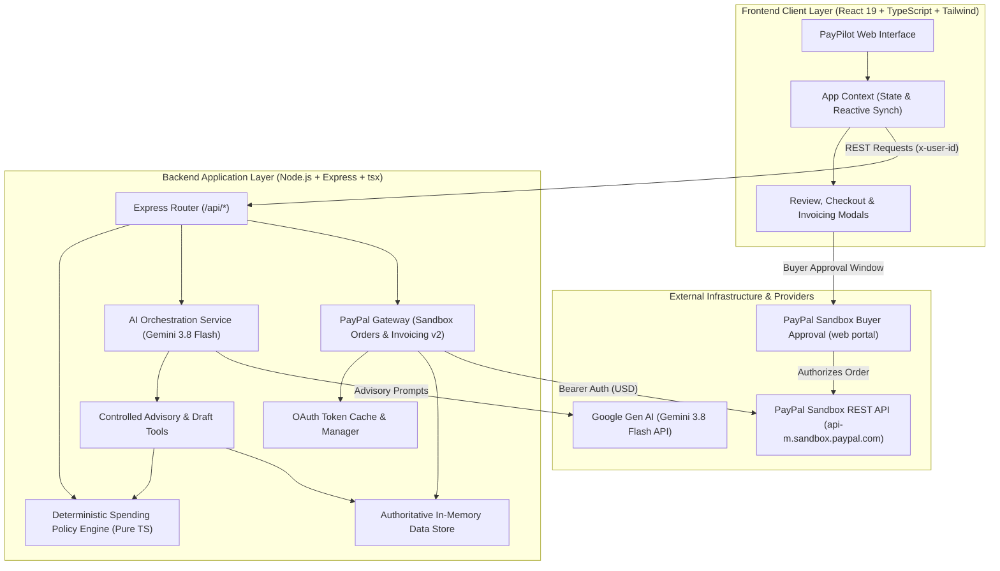
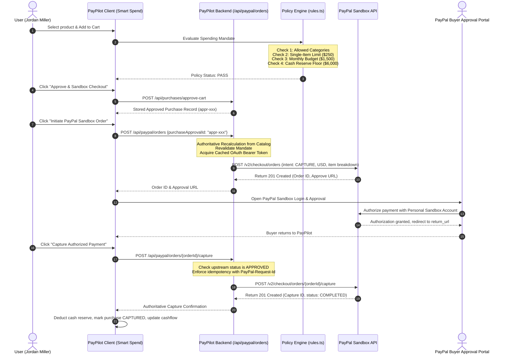

# PayPilot AI: System Architecture & Technical Specifications

This document details the architectural design, security boundaries, and data pipelines powering **PayPilot AI**.

---

## 1. System Architecture Diagram



---

## 2. Financial Transaction Flow Diagram



---

## 3. Frontend & Backend Modular Architecture

### Frontend (React 19 SPA)
- **Directory Structure**:
  - `src/components/`: Modular widgets divided into `invoice/`, `layout/`, `overview/`, and `spend/`.
  - `src/context/`: Single authoritative context (`AppContext.tsx`) providing deterministic synchronization across all views.
  - `src/pages/`: Modular route views (`FinancialOverviewPage`, `SmartSpendPage`, `InvoicesPage`, `CashflowForecastPage`, `AssistantPage`, `ActivityApprovalsPage`, `SettingsPage`).
  - `src/utils/`: Pure rules, arithmetic helpers, and deterministic cashflow generators.

### Backend (Node.js & Express)
- **Entry Point**: `server.ts` mounts Express with safe CORS headers, body parsers, and Vite middleware in development or static asset serving in production.
- **API Router**: `src/server/routes.ts` defines all `/api/*` endpoints with structured HTTP error codes and user isolation checks.
- **PayPal Service**: `src/server/paypal.ts` encapsulates OAuth token lifecycle, order creation, and capture idempotency.
- **Invoicing Service**: `src/server/paypalInvoicing.ts` handles invoice draft generation, transmission, reminder dispatching, and webhook signature verification.
- **Gemini Service**: `src/server/gemini.ts` orchestrates conversational intelligence with strictly scoped tool declarations and deterministic fallback handling.

---

## 4. AI Orchestration & Tool Execution Pipeline

```
User Message -> Pre-Authorization Check -> Gemini 3.8 Flash (or Fallback Engine)
                     |
         [Is Action Prohibited?]
        /                       \
     YES                         NO
      |                           |
Reject with Security Violation   Execute Controlled Tool:
                                 - searchCatalog
                                 - getSpendingMandate
                                 - evaluateCartPolicy
                                 - getInvoices
                                 - prepareInvoiceDraft
                                 - getCashflowForecast
                                 - simulateExpenseImpact
                                 - getRecentPurchases
                                          |
                                 Grounded, Truthful Output to User
```

1. **Boundary Enforcement**: Incoming prompts are checked against `UNAUTHORIZED_ACTIONS`. Any attempt to trigger financial disbursements or invoice dispatching bypasses the LLM and directly returns an authorization denial.
2. **Schema Containment**: Only controlled tools are exposed to the model. Tool definitions explicitly communicate that drafts require human review before transmission.
3. **Deterministic Fallback Engine**: If no `GEMINI_API_KEY` is provided, PayPilot activates a rule-based deterministic response engine that answers all domain queries using live application state.

---

## 5. Deterministic Spending Policy Engine

The policy evaluation engine (`evaluateSpendingPolicy` in `src/utils/rules.ts`) is a pure function that takes the current cart, active spending mandate, demo cash balance, and minimum cash reserve floor.

It deterministically evaluates four rules:

1. **RULE_ALLOWED_CATEGORIES**: Verifies every cart item belongs to `mandate.allowedCategories` and is not present in `mandate.restrictedCategories`.
2. **RULE_SINGLE_ITEM_LIMIT**: Ensures no individual item price exceeds `mandate.maxSingleItemLimit` ($250.00 default).
3. **RULE_MONTHLY_BUDGET**: Ensures `currentSpentThisMonth + cartTotal <= mandate.monthlyBudget` ($1,500.00 default).
4. **RULE_CASH_RESERVE_FLOOR**: Assesses whether `availableDemoCash - cartTotal < minimumReserve` ($6,000.00 default). Dips below the floor trigger a `WARNING` status requiring managerial confirmation.

---

## 6. Authoritative Shared Data Store

In-memory data structures provide persistence across client sessions and sandbox orders without external database dependencies:

- `purchaseApprovalsStore: Map<string, PurchaseApproval>`: Authoritative purchase approval records, policy summaries, and timestamps.
- `ordersStore: Map<string, StoredPayPalOrder>`: PayPal Orders mapped to internal approval records, capture IDs, and idempotency keys.
- `invoicesStore: Map<string, Invoice>`: PayPal invoices mapped to payment terms, live PayPal status, and settlement classifications.
- `seenWebhookEventIds: Set<string>`: Cryptographic replay prevention cache for webhook notifications.

---

## 7. PayPal Invoicing API v2 & Webhook Architecture

- **Schema Mapping**: Due dates are mapped to `term_type: 'DUE_ON_DATE_SPECIFIED'` with `due_date: YYYY-MM-DD` in compliance with PayPal Invoicing v2 specifications.
- **Dispatching**: Sending an invoice via `POST /v2/invoicing/invoices/{id}/send` triggers PayPal's notification service to dispatch an official sandbox invoice to the client's email address.
- **Status Reconciliation**: `GET /v2/invoicing/invoices/{id}` fetches live status updates from PayPal servers.
- **Webhook Signature Verification**: Incoming webhook notifications verify:
  1. The `paypal-cert-url` originates strictly from `*.paypal.com`.
  2. Signature headers (`paypal-transmission-sig`, `paypal-transmission-time`, `paypal-auth-algo`) are cryptographically verified.
  3. Duplicate event IDs are dropped to prevent double processing.

---

## 8. Dynamic 12-Week Cashflow Engine

The cashflow engine (`generateDynamicCashflowForecast` in `src/utils/rules.ts`) generates 12 sequential weekly liquidity forecast points:

- **Starting Cash**: Week 0 starting cash is strictly equal to current demo cash.
- **Receivables Scheduling**: Unpaid invoices (`sent`, `overdue`) are scheduled according to their due date window. Paid invoices are already in starting cash and are excluded from future incoming to prevent double-counting.
- **Outgoings Scheduling**: Approved, uncaptured purchases are scheduled in Week 0. Captured purchases are already deducted from opening cash and are never deducted twice.
- **Probabilistic Modeling**:
  - $P50_w = S_w + I_w - O_w$
  - $P20_w = P20_{w-1} + (0.70 \cdot I_w) - (1.08 \cdot O_w)$ (stress test)
  - $P80_w = P80_{w-1} + (1.05 \cdot I_w) - (0.95 \cdot O_w)$ (upside)
